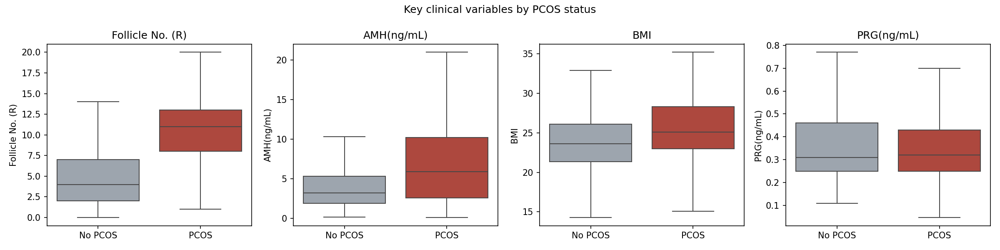
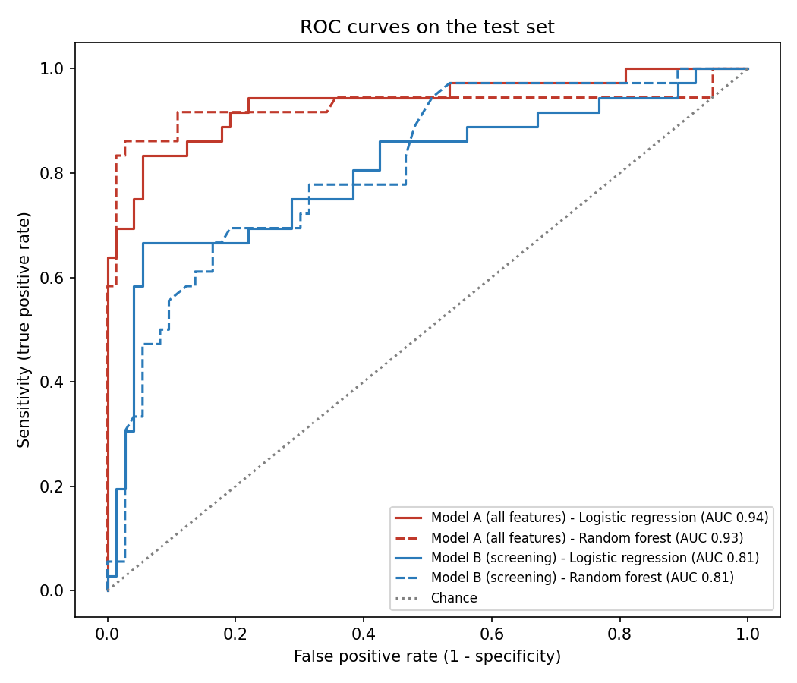

# Predicting PCOS from routine clinical data

I built and evaluated models that predict polycystic ovary syndrome (PCOS) from clinical, hormonal and ultrasound data of 541 women from 10 hospitals in Kerala, India.

**Author:** Dr. Abhijeet Satapathy, BDS · PGDM (AI & Data Science in Healthcare), IIHMR Bangalore

## Question
Can routine clinical data predict PCOS, and can it flag PCOS *without* the diagnostic criteria (cycle irregularity, hyperandrogenism and ultrasound follicle count)?

## Results

| Model | Features | Test AUC |
|---|---|---|
| Logistic regression | All (Model A) | 0.935 |
| Random forest | All (Model A) | 0.928 |
| Logistic regression | Screening, no diagnostic criteria (Model B) | 0.810 |
| Random forest | Screening, no diagnostic criteria (Model B) | 0.811 |

- Model A performs very well, but mainly because it contains the Rotterdam diagnostic criteria.
- Model B, without them, is a modest triage aid: at a screening cut-off it detects 89% of PCOS cases but flags 71% of women for ultrasound.
- The strongest screening predictors are low progesterone, weight gain, skin darkening, raised AMH and waist size, consistent with anovulation and insulin resistance.

## Method
1. **Cleaning:** column names, data types, missing values, and clinical review of 10 implausible values
2. **Exploration:** median (IQR) comparisons with Mann-Whitney U tests, box plots and symptom prevalence
3. **Modelling:** logistic regression and random forest on two feature sets
4. **Validation:** stratified 80/20 split, 5-fold cross-validation, and a screening cut-off chosen on training data only
5. **Evaluation:** AUC, ROC curves, confusion matrices, sensitivity, specificity, PPV, NPV and odds ratios
6. **Sensitivity analysis:** removing the skewed FSH/LH ratio

## Limitations
Small single-region sample; the cycle day of hormone sampling is unknown; self-reported symptoms; associations, not causes.

## How to run
Open `pcos_analysis.ipynb` in Google Colab or Jupyter. Download the data from Kaggle (link below) and place `PCOS_data_without_infertility.xlsx` in the same folder.

## Data
Kottarathil P. *Polycystic ovary syndrome (PCOS)*. Kaggle, 2020. https://www.kaggle.com/datasets/prasoonkottarathil/polycystic-ovary-syndrome-pcos (licence: CC BY-NC-SA 4.0)
